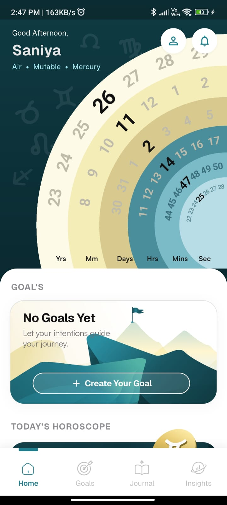
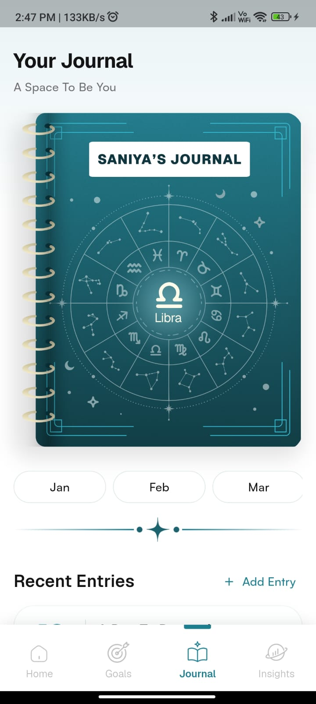
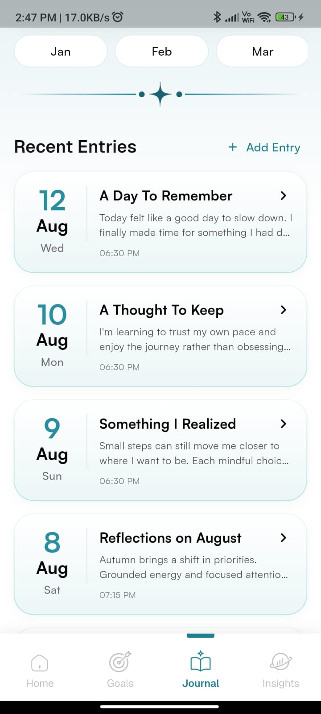
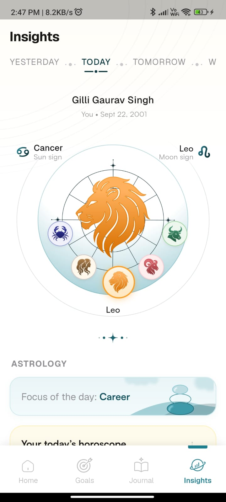
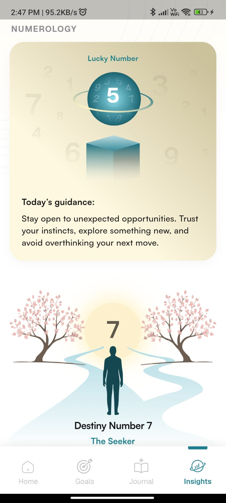
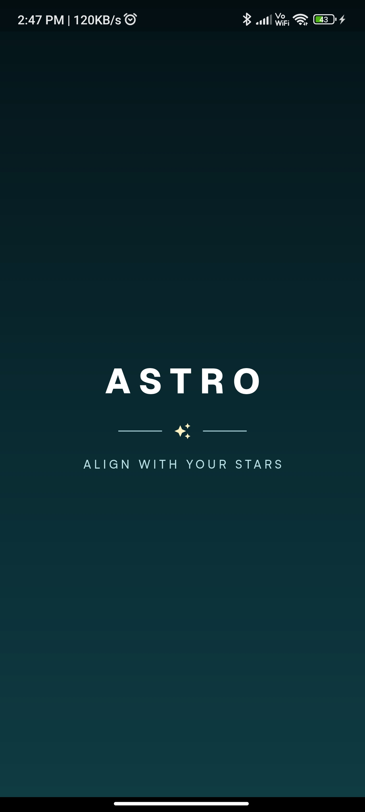

# Astrology & Horoscopes App

A Flutter application developed based on the provided Figma design, featuring horoscopes, astrology insights, numerology, and a personal journal.

## Features
- **Home:** Time dial, goals, horoscope, and numerology.
- **Journal:** Journal entries, month selection, and pull-to-refresh.
- **Insights:** Daily, weekly, and monthly insights, astrology profile, and numerology.

## Technologies Used
- Flutter & Dart
- flutter_bloc
- equatable
- flutter_screenutil
- device_preview_plus

## Architecture
The project follows Clean Architecture:

- **Presentation:** Screens, widgets, BLoC, events, and states.
- **Domain:** Entities and repository interfaces.
- **Data:** Models, data sources, and repositories.

BLoC manages application state and user interactions.

## Flutter Version
- Flutter: 3.13.1 or higher
- Dart: 3.1.0 or higher

## Setup & Run

```bash
git clone YOUR_GITHUB_REPOSITORY_URL
cd test_app
flutter pub get
flutter run
```

## Screenshots
### Home


### Journal



### Insights



### Splash


## App Demo
[Watch Screen Recording](https://drive.google.com/file/d/16OOI_MMl4t-WAbpOzoo0bOMrCLTfGsg1/view?usp=sharing)

## Assumptions
- Mock data is used for Journal and Insights.
- Image assets are used for illustrations and decorative elements.
- Responsive layouts are supported using ScreenUtil and AppResponsive.

